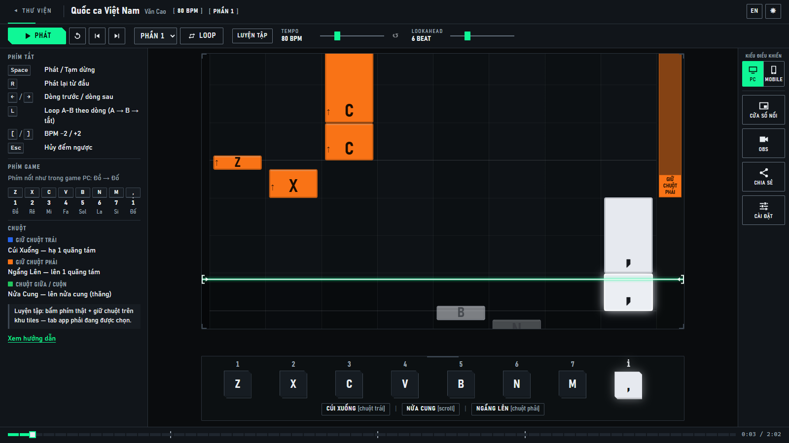
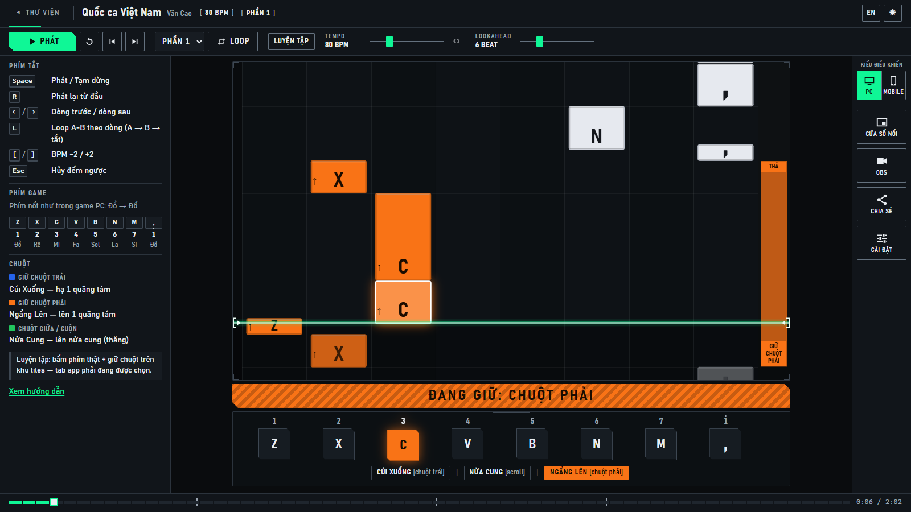
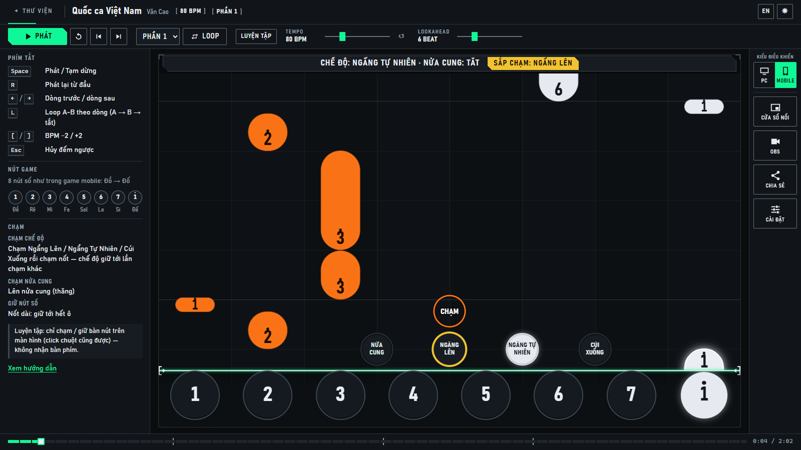
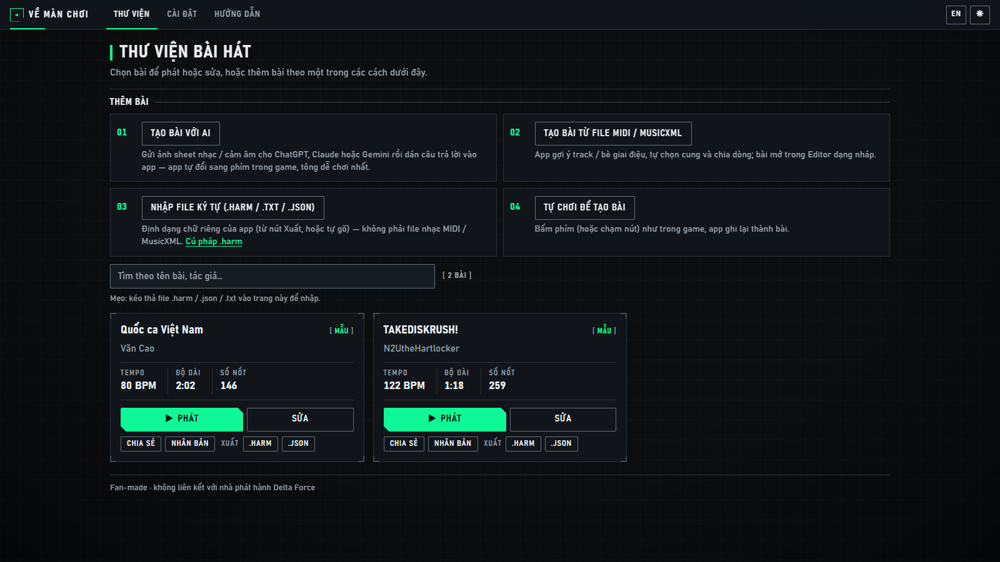
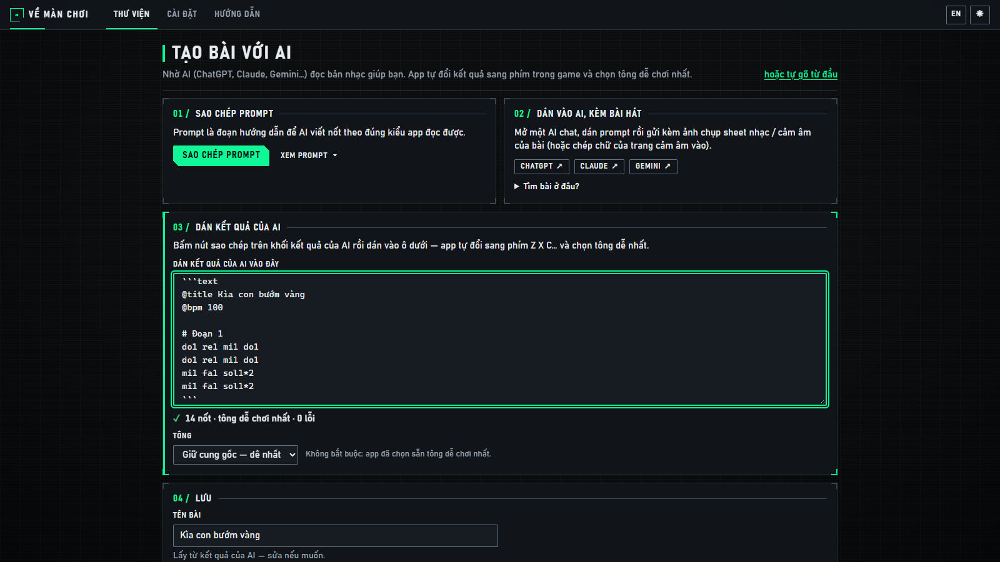
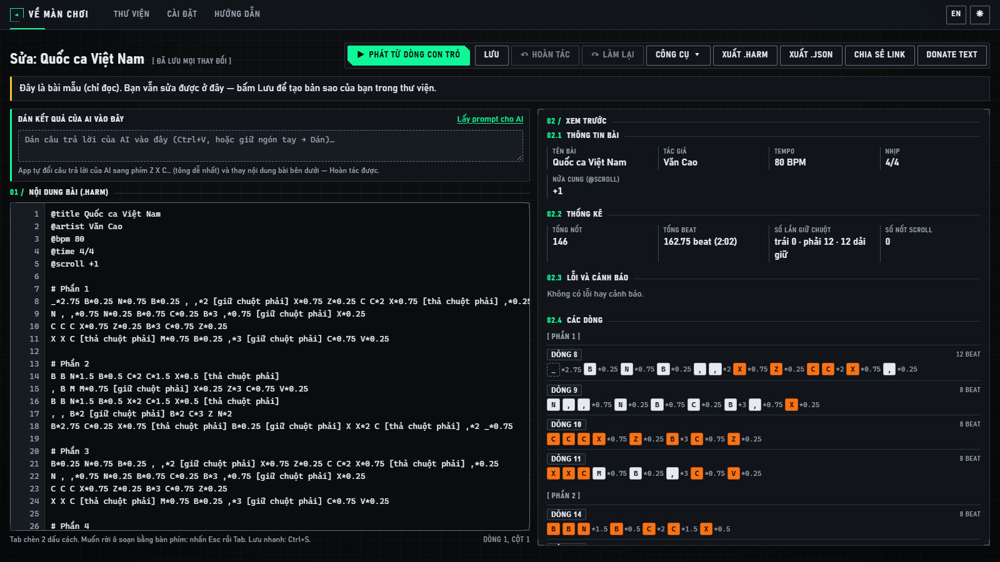
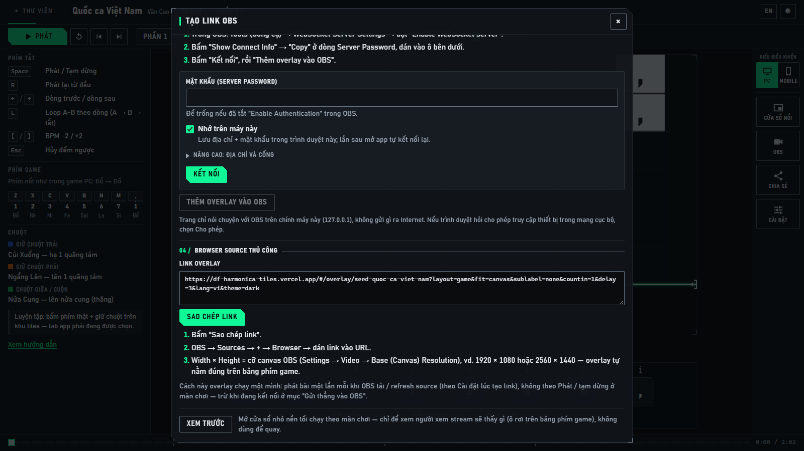
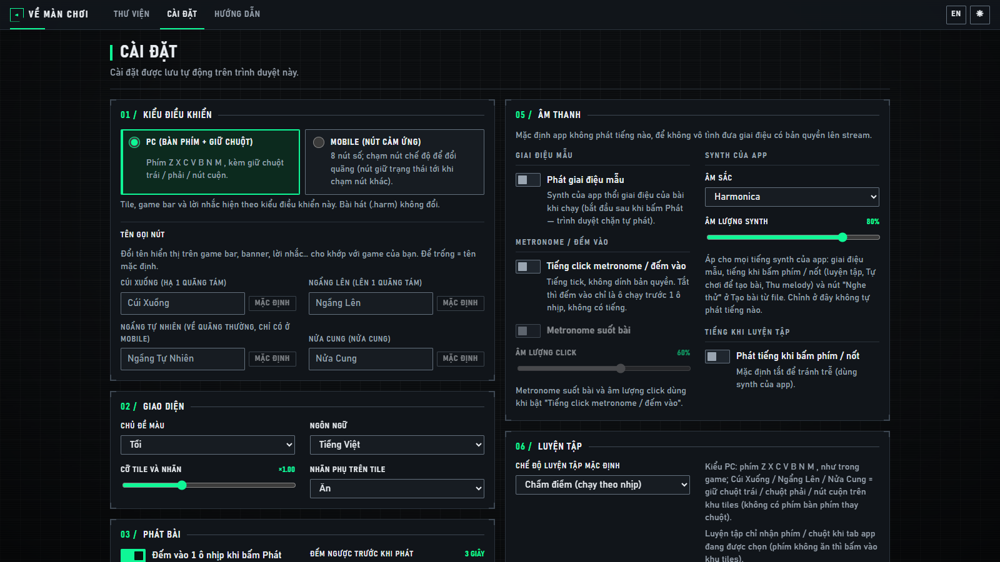

# Delta Force Harmonica Tiles

> **English:** a free web app that shows Piano-Tiles-style falling notes for the harmonica in _Delta Force_ — you
> press the real keys in the game yourself; the app never sends input to the game, needs no account and keeps your
> songs in your browser. PC and mobile control schemes, songs from an AI chat's reading of a sheet-music photo or
> from MIDI / MusicXML files, and a silent OBS overlay that follows the player. The UI defaults to Vietnamese (EN
> button at the top right). Fan-made · not affiliated with the publisher of Delta Force.

**Dùng ngay:** **https://df-harmonica-tiles.vercel.app** — mở là chơi, không phải tải hay cài gì.

App hiện **ô rơi theo nhịp** kiểu Piano Tiles cho kèn harmonica trong Delta Force: ô chạm vạch sáng là lúc bạn bấm
phím **trong game**. App **không bao giờ bấm thay bạn**, không cần tài khoản, bài lưu ngay trong trình duyệt của bạn.
_Fan-made · không liên kết với nhà phát hành Delta Force_ — không dùng logo, font hay hình ảnh nào của game.



## Mục lục

- [Bắt đầu nhanh](#bắt-đầu-nhanh)
- [Những chỗ hay nhầm](#những-chỗ-hay-nhầm)
- [Thêm bài](#thêm-bài)
- [Luyện tập](#luyện-tập)
- [Stream với OBS](#stream-với-obs)
- [Cửa sổ nổi trên game (PC)](#cửa-sổ-nổi-trên-game-pc)
- [Điện thoại](#điện-thoại)
- [Chia sẻ link](#chia-sẻ-link)
- [Cài đặt](#cài-đặt)
- [Mã nguồn & giấy phép](#mã-nguồn--giấy-phép)
- [Cho người phát triển](#cho-người-phát-triển)

## Bắt đầu nhanh

1. Mở link **https://df-harmonica-tiles.vercel.app** — màn đầu là **màn chơi**, mở sẵn bài mẫu _"Quốc ca Việt Nam"_.
2. Bấm **Phát** (hoặc Space). Số to đếm ngược **3 giây** để bạn kịp Alt-Tab vào game, rồi ô bắt đầu rơi.
3. Ô chạm vạch sáng → bấm đúng phím ghi trên ô **trong game**. Màu ô cho biết có phải giữ nút chuột không.
4. Bài khác: **◂ Thư viện** (góc trên trái) → **Phát** trên thẻ bài. Bài mới: Thư viện → **Tạo bài với AI**.
5. Chơi bản điện thoại của game? Bấm **Mobile** ở thanh dọc bên phải.

Trên màn chơi: thanh điều khiển (**Phát**, **Từ đầu**, **Loop**, **Luyện tập**, nút loa, **Tempo**, **Lookahead** =
số beat thấy trên màn…); cột trái là phím tắt và cách bấm (màn hẹp: nút **?**); thanh dọc phải có **Kiểu điều khiển**
(**PC** | **Mobile**), **Cửa sổ nổi**, **OBS**, **Chia sẻ**, **Cài đặt**; đáy là thanh vị trí (kéo để tua). Nút
**Thu gọn thanh trên** (góc trên phải) ẩn tên bài + thanh điều khiển để khu tiles cao tối đa; góc trên phải khu tiles
còn nút Phát nhỏ và nút **Hiện thanh trên**. Ở các trang khác, nút **◂ Về màn chơi** đưa bạn về bài vừa chơi.

## Những chỗ hay nhầm

### Ô màu gì thì giữ chuột gì? (PC)



Kèn trong game có **8 phím nốt** `Z X C V B N M ,` (Đồ Rê Mi Fa Sol La Si Đố) và **3 nút chuột giữ**. Chữ to trên ô
là phím cần bấm; ô càng dài, nốt càng ngân lâu. **Màu ô** cho biết cần **giữ** nút chuột nào trong lúc bấm:

- trắng xám: chỉ bấm phím;
- **xanh dương**: giữ **chuột trái** = **Cúi Xuống** (thấp 1 quãng tám);
- **cam**: giữ **chuột phải** = **Ngẩng Lên** (cao 1 quãng tám);
- **xanh lá**: giữ **nút cuộn** (bấm bánh xe) = **Nửa Cung**; ô xanh dương / cam có huy hiệu `#` = giữ thêm nút cuộn.

**Dải giữ** ở cột hẹp bên phải ghi `GIỮ CHUỘT PHẢI` … `THẢ`; banner `ĐANG GIỮ: …` nhắc bạn đang trong một đoạn giữ.
**Game bar** dưới khu ô rơi sáng đúng phím và nút chuột đang cần.

### Vòng "CHẠM" là gì? (Mobile)



Bản điện thoại của game có **8 nút tròn** (số `1 … 7 1`, có chấm) và **4 nút chế độ** `Nửa Cung · Ngẩng Lên · Ngẩng
Tự Nhiên · Cúi Xuống` — **chạm để chọn**, chế độ giữ nguyên tới khi chạm nút khác.

- Ô rơi **thẳng vào nút tròn** của nó; ô chạm đỉnh nút là lúc bấm. Chấm trên số = quãng cao, chấm dưới = quãng thấp.
- **Vòng `CHẠM`**: vòng tròn rỗng (chỉ có viền màu của chế độ, nhìn xuyên qua được), to đúng bằng nút chế độ, giữa
  ghi `CHẠM`. Vòng rơi **nhanh hơn ô** (nên hiện ra muộn hơn) và **trùng khít nút chế độ đúng lúc phải chạm** — thấy
  vòng "đáp" vào nút là chạm (chữ `CHẠM` mờ đi ngay trước đó để bạn đọc được tên nút). Nút chế độ sắp phải chạm có **vòng vàng**; banner ghi chế độ đang chọn. **Cửa sổ nổi**
  kiểu Mobile và trang mini **Thu nhỏ** có bàn nút kiểu game với vòng `CHẠM` y như vậy; trang mini **Khớp nút game**
  và overlay OBS chỉ vẽ 4 vòng mờ ở chỗ nút chế độ — nút thật của game nằm ngay dưới (xem [Xem trước](#xem-trước),
  [Điện thoại](#điện-thoại)).
- Nút **Nửa Cung** của bản mobile chạy kiểu nào **chưa được xác nhận**: chọn ở Cài đặt → **Nút Nửa Cung hoạt động
  kiểu** (_Bật / tắt_ hoặc _Chỉ áp cho 1 nốt_).

### Số đếm 3-2-1 và đếm vào

Số to chỉ hiện trong lúc **đếm ngược** (mặc định 3 giây; Space / Esc để hủy). Bấm Phát là ô **lùi mượt** lên một
đoạn ngắn rồi **đứng yên đúng chỗ sẽ bắt đầu chạy** — nốt đầu thường đã nằm sẵn trên làn, cách vạch sáng chừng 2/3 ô
nhịp; bài có đoạn lặng trước nốt đầu thì cao hơn (_"Quốc ca Việt Nam"_: chừng 1 ô nhịp — 4,4 beat). Hết số là ô chạy
luôn: **đếm vào** (mặc định bật) chỉ là đoạn ô chạy dẫn vào tới nốt đầu, **không có số đếm** (bật tiếng click thì có
tick theo nhịp). Không lúc nào ô nhảy cóc — kể cả khi tắt đếm ngược mà vẫn bật đếm vào. Đổi cả hai ở
Cài đặt → **Phát bài** — áp cho màn chơi, **Cửa sổ nổi** và trang mini; riêng Cửa sổ nổi, trang mini và video nổi
luôn đếm ngược **ít nhất 3 giây** (kể cả khi chọn Tắt) để bạn kịp chuyển vào game sau khi bấm ▶.

### Cửa sổ nổi không nằm trên game?

Game phải chạy **Borderless** hoặc **Windowed** — Fullscreen thật che mọi cửa sổ khác. Cửa sổ nổi chỉ có trên Chrome /
Edge máy tính (xem [Cửa sổ nổi trên game](#cửa-sổ-nổi-trên-game-pc)).

### OBS chỉ hiển thị

Overlay OBS **chạy theo màn chơi**: cùng bài, cùng lúc Phát / Tạm dừng / tua / tempo / loop, cùng kiểu điều khiển.
Mọi chỉnh làm ở màn chơi; hộp thoại OBS chỉ có vài tùy chọn hiển thị. Overlay luôn im lặng.

### Bài vừa tạo biến mất?

**Tạo bài với AI** → **Lưu** là bài vào Thư viện ngay. Còn **Tạo bài từ file MIDI / MusicXML**, **Tự chơi để tạo
bài**, **Mở trong Editor**, **hoặc tự gõ từ đầu** mở bài trong trình soạn dạng **bản nháp** (**Bản nháp — chưa
lưu**): bài **chưa vào Thư viện** tới khi bạn bấm **Lưu** (Ctrl+S); chưa sửa gì mà rời đi, hoặc tải lại trang, là
mất. Bài mẫu (huy hiệu **Mẫu**) chỉ đọc: sửa rồi **Lưu** sẽ tạo bản sao của bạn.

### Tạo bài nhanh nhất: nhờ AI

Thư viện → **Tạo bài với AI** → sao chép prompt → dán vào ChatGPT / Claude / Gemini kèm **ảnh sheet nhạc / cảm âm**
→ dán câu trả lời của AI vào ô **Dán kết quả của AI vào đây** → **Lưu**. App tự đổi sang phím trong game, chọn tông
dễ chơi nhất. AI **có thể đọc sai nốt** — luôn phát thử. Chi tiết: [Tạo bài với AI](#tạo-bài-với-ai).

### Không nghe thấy tiếng gì?

**Mặc định app im lặng**: giai điệu phát trên stream có thể bị YouTube / Facebook / TikTok bắt bản quyền. Luyện riêng
mà muốn nghe: bấm **nút loa** trên thanh điều khiển (ngay trước **Tempo**; rê chuột hiện **Bật tiếng giai điệu**) → hộp
cảnh báo bản quyền → **Tôi hiểu, bật** — hoặc Cài đặt → **Âm thanh** → **Phát giai điệu mẫu**, cùng một công tắc. Khi
đang bật, nút loa đỏ và màn chơi có huy hiệu đỏ **🔊 Đang phát giai điệu** (điện thoại: ô đỏ **[🔊]**) để bạn nhớ tắt
trước khi lên sóng; bấm nút loa lần nữa (**Tắt tiếng**) là tắt ngay, không hỏi. Overlay OBS, trang mini và video nổi
luôn im lặng.

**iPhone:** tiếng giờ phát **cả khi gạt nút im lặng bên hông** (khi đang bật tiếng, nhạc của app khác có thể tạm dừng;
tắt nút loa hoặc rời màn chơi là trả lại). Vẫn không nghe: tăng âm lượng bằng nút bên hông lúc đang mở màn chơi, tắt
chế độ tập trung, rồi chạm **Phát** lần nữa. **Android:** dùng âm lượng nhạc / media của máy.

### iPhone làm được gì?

Màn chơi, Thư viện, Tạo bài với AI, kiểu **Mobile** và luyện bằng chạm dùng bình thường (xoay ngang cho giống game).
iPhone không có cửa sổ nổi cho trang web, nhưng có **video nổi** luôn nằm trên game: thanh dọc → **Cửa sổ nổi** → chọn
**Apple — iPhone / iPad** (chỉ hỏi lần đầu; đổi bằng **Đổi loại điện thoại**) → app dựng video của bài ngay (giữ trang
mở, màn hình sáng tới 100 %) → chạm **Mở video nổi** → chuyển sang game, video đếm ngược rồi chạy. Đóng hộp thoại
không tắt video đang mở. Không có rung khi chạm, không dùng được đàn MIDI.

### Bài của tôi ở máy khác đâu?

Bài lưu **trong trình duyệt này, trên máy này** (Chrome không thấy bài của Edge, điện thoại không thấy bài của PC, OBS
cũng có bộ nhớ riêng). Mang bài sang máy khác: [gửi link chia sẻ](#chia-sẻ-link) rồi **Lưu vào thư viện** ở máy kia.
Sao lưu bằng nút **.json** / **.harm** trên thẻ bài — xóa dữ liệu duyệt web là mất bài.

## Thêm bài



**Thư viện** có bốn **bài mẫu** (huy hiệu **Mẫu**: _"Quốc ca Việt Nam"_, _"TAKEDISKRUSH!"_, _"寂寞的人伤心的歌"_ và _"Sao Mình Chưa Nắm Tay Nhau"_)
và **bài của bạn**. Bài mẫu là bản ký âm giai điệu để minh họa — bản quyền bài hát thuộc về tác giả (ghi trên thẻ bài
và màn chơi). Mỗi thẻ bài: **Phát**, **Sửa**, **Chia sẻ**, **Nhân bản**, xuất **.harm** / **.json**, **Xóa**. Mục **Thêm
bài** ở đầu trang có 4 cách:

1. **Tạo bài với AI** — từ ảnh sheet nhạc / cảm âm. Dễ nhất.
2. **Tạo bài từ file MIDI / MusicXML** — từ file nhạc tải về (vd. MuseScore).
3. **Nhập file ký tự (.harm / .txt / .json)** — file chữ của chính app.
4. **Tự chơi để tạo bài** — bấm như trong game, app ghi lại.

### Tạo bài với AI



1. **Sao chép prompt** (trình duyệt chặn sao chép thì bấm **Xem prompt** rồi tự chép).
2. Mở ChatGPT, Claude hoặc Gemini (link có sẵn trên trang), dán prompt và **gửi kèm ảnh chụp sheet nhạc / cảm âm**
   (hoặc chép chữ của trang cảm âm). Chỉ gửi tên bài thì AI hay đoán sai. Mẹo: mục **Tìm bài ở đâu?** trên trang.
3. Bấm nút sao chép trên khối kết quả của AI, dán vào ô **Dán kết quả của AI vào đây**. App đổi ngay sang phím
   `Z X C…` (kèm giữ chuột / Nửa Cung), chọn **tông dễ chơi nhất** và ghi số nốt + chỗ không đọc được. Đổi tông ở ô
   **Tông** nếu muốn (không bắt buộc). Bài dài mà AI trả lời thành **nhiều phần**: dán tiếp phần sau vào **cuối** ô —
   app ghép theo thứ tự (dòng kết quả ghi "ghép 2 phần").
4. Sửa **Tên bài** nếu muốn → **Lưu** là xong. Muốn chỉnh nốt / nhịp trước: **Mở trong Editor** (bản nháp).

Tự gõ nốt từ đầu: link **hoặc tự gõ từ đầu** ở đầu trang. Nguồn không có nhịp thì mọi nốt dài 1 beat — gõ lại nhịp
bằng **Công cụ** → **Tap timing (gõ nhịp)** trong trình soạn. Prompt đầy đủ và nơi tìm nguồn:
[hướng dẫn prompt AI](docs/AI-PROMPT-CAM-AM.md) (có [bản tiếng Anh](docs/AI-PROMPT-CAM-AM.md#english-version)).

### Tạo bài từ file MIDI / MusicXML

Kéo thả file `.mid` / `.musicxml` / `.mxl` (app không tải bài từ đường link — tải file về trước) rồi đi qua 5 bước:
**Chọn file** → **Chọn track** (track **Gợi ý** đã chọn sẵn; giai điệu thường có số nốt mỗi phút gần bằng BPM; bấm
**Nghe thử** để chắc) → **Trích melody** → **Chọn cung và quãng** (**Tối ưu** = ít giữ chuột nhất; chơi theo nhạc gốc
thì **Giữ cung gốc**) → **Xem trước và tạo bài** → **Mở trong Editor** (bản nháp) → **Lưu**. File chỉ được đọc trên
máy bạn; bản nhạc nhiều bè / hợp âm có thể bị trích sai nốt. Tab **Thu melody** thu giai điệu bằng đàn MIDI.

### Nhập file ký tự

Bấm **Nhập file ký tự (.harm / .txt / .json)** (hoặc kéo thả file vào trang Thư viện): bài vào Thư viện ngay. Đây là
**định dạng chữ riêng của app** — có từ nút **Xuất .harm** / **Xuất .json** hoặc nút **.harm** / **.json** trên thẻ
bài — không phải file MIDI / MusicXML. File lỗi cú pháp vẫn nhập được; thẻ bài có nút **Xem dòng bị lỗi**.

### Cú pháp .harm

Ít khi phải gõ tay, nhưng nếu cần thì đây là phần hay dùng:

```text
@title Bài ví dụ
Z X C V B*2 _ N*.5 M*.5
[giữ chuột phải] Z X C [thả chuột phải] L:N
```

| Viết                                    | Nghĩa                                                         |
| --------------------------------------- | ------------------------------------------------------------- |
| `Z X C V B N M ,`                       | 8 phím nốt (Đồ … Đố), cách nhau bằng dấu cách                 |
| `B*2` `N*.5` · `_`                      | độ dài tính bằng beat (mặc định 1) · nghỉ                     |
| `X-C`                                   | luyến: các nốt chia nhau 1 beat                               |
| `[giữ chuột trái]` … `[thả chuột trái]` | giữ Cúi Xuống (`chuột phải` = Ngẩng Lên, `scroll` = Nửa Cung) |
| `L:N` `R:Z` `S:C`                       | giữ trái / phải / scroll cho đúng một nốt                     |
| `@title` `@artist` `@bpm` `# Đoạn` `//` | tên bài, tác giả, tempo, tên đoạn, ghi chú                    |

Trình soạn báo lỗi ngay (dòng, cột) ở mục **Lỗi và cảnh báo**; bấm vào lỗi để nhảy tới đúng chỗ.

### Tự chơi để tạo bài

Đặt **Tên bài**, **Tempo (BPM)**, **Nhịp** → **● Thu** → đèn nhịp đếm vào 1 ô nhịp → chơi (PC: phím + giữ chuột trong
khung thu; Mobile: chạm nút chế độ + nút số) → **Dừng** → **Mở trong Editor** (bản nháp) → **Lưu**. **Thu lại** /
**Hoàn tác** nếu chưa ưng.

### Sửa bài trong trình soạn



**Sửa** trên thẻ bài mở trình soạn: văn bản **Nội dung bài (.harm)** bên trái, **Xem trước** bên phải.

- Ô **Dán kết quả của AI vào đây** ngay trên văn bản: dán câu trả lời của AI là bài được thay bằng kết quả (tông dễ
  nhất; **Hoàn tác** để quay lại; gõ tay vào ô thì bấm **Áp dụng**) → **Lưu**. Văn bản dán không có tempo / nhịp / tên
  bài thì giữ của bài đang sửa. **Lấy prompt cho AI** mở trang Tạo bài với AI ở tab mới.
- **Công cụ:** **Tap timing (gõ nhịp)**, **Tối ưu lại cung / quãng** (ít giữ chuột / Nửa Cung hơn).
- **Phát từ dòng con trỏ**, **Lưu** (Ctrl+S), **Xuất .harm** / **Xuất .json**, **Chia sẻ link**, **Donate text**
  (chia bài thành nhiều tin ngắn để gửi qua donate).

## Luyện tập

Bấm **Luyện tập** trên thanh điều khiển: app chấm từng nốt bạn bấm. **Chờ** = bài dừng ở mỗi nốt tới khi bạn bấm
đúng; **Chấm điểm** = chạy theo nhịp, chấm **Perfect** / **Good** / **Miss**, có combo và **Kết quả luyện tập**.

- **PC:** phím thật `Z X C V B N M ,` + **giữ chuột trái / phải / nút cuộn trên khu ô rơi**, y như game.
- **Mobile:** chạm / giữ **bàn nút trên màn hình** (nút chế độ trước, rồi nốt; trên máy tính thì click).
- Phím không ăn? Tab app phải **đang được chọn** — bấm một cái vào khu ô rơi.
- Có đàn MIDI (kiểu PC): Cài đặt → **MIDI** → **Bật MIDI**.

## Stream với OBS

Overlay OBS **chỉ có ô rơi**, nền trong suốt, **luôn im lặng**, tự nằm đúng trên bảng phím kèn của game và **chạy
theo màn chơi**. Bấm **OBS** ở thanh dọc màn chơi → hộp thoại **Tạo link OBS** cho bài đang mở: chọn **Kiểu overlay**
(**Khớp bảng phím game** là mặc định), **Độ đậm của ô**, **Cỡ giao diện game (tinh chỉnh)** (để 100 % nếu UI scale
trong game là mặc định), rồi chọn **một trong hai cách** dưới đây. Lựa chọn được nhớ cho lần sau.



### Cách 1: Gửi thẳng vào OBS (khuyên dùng)

Cần OBS 28 trở lên, cùng máy với trình duyệt.

1. OBS → **Tools** → **WebSocket Server Settings** → tick **Enable WebSocket server** → **Apply**.
2. Cũng cửa sổ đó: **Show Connect Info** → **Copy** ở dòng **Server Password**.
3. Mục **Gửi thẳng vào OBS (khuyên dùng)** → dán vào **Mật khẩu (Server Password)** → **Kết nối**.
4. **Thêm overlay vào OBS** → app tạo Browser Source **DF Harmonica Tiles** đúng cỡ, đúng chỗ. Xong — chơi ở màn
   chơi như bình thường (giữ tab màn chơi mở), overlay trong OBS chạy theo.

Đổi kiểu overlay sau đó → **Cập nhật overlay trong OBS**. **Nhớ trên máy này** = lần sau mở app tự kết nối lại. Trình
duyệt hỏi quyền truy cập mạng cục bộ thì chọn Cho phép.

### Cách 2: Browser Source thủ công

**Sao chép link** → OBS → Sources → **+** → **Browser** → dán vào **URL** → **Width × Height = cỡ canvas OBS**
(Settings → Video → **Base (Canvas) Resolution**, vd. 1920 × 1080), source ở góc 0, 0. Cách này overlay **chạy một
mình**: phát bài **một lần** mỗi khi OBS tải / refresh source, **không** theo Phát / Tạm dừng ở màn chơi (trừ khi
đang kết nối theo Cách 1). Chạy lại: chuột phải source → **Refresh**.

### Xem trước

Nút **Xem trước** ở cuối hộp thoại mở một cửa sổ nhỏ **nền tối**, chạy theo màn chơi, có bảng phím game vẽ minh họa —
chỉ để **xem người xem stream sẽ thấy gì**. Không dùng cửa sổ này để quay. Kiểu **Mobile**: overlay (và Xem trước)
**không** vẽ bàn nút — trên stream nút thật của game nằm ngay bên dưới — chỉ có 4 vòng mờ đánh dấu 4 nút chế độ, vòng
`CHẠM` rơi vào đúng vòng đó.

## Cửa sổ nổi trên game (PC)

Một màn hình, chỉ cần **chính bạn** nhìn ô rơi trên game: kiểu **PC** → **Cửa sổ nổi** ở thanh dọc. Cửa sổ nhỏ **luôn
nằm trên game** mở ra (nút ghi **Đang mở**, bấm lần nữa để đóng). Bấm **Căn chỉnh** → kéo cửa sổ tới ngay trên bảng
phím kèn, giãn cho 8 vạch thẳng 8 phím → Esc → ▶ → đếm ngược (theo Cài đặt → **Phát bài**, ít nhất 3 giây) →
**bấm vào game** và chơi theo.

Cửa sổ mở sẵn ở **cỡ chuẩn của màn hình bạn**: rộng bằng **khung bảng phím** của game (8 cột đúng 8 phím, hai bên
chừa khoảng như viền của game nên ô ngoài cùng không sát mép) cộng dải giữ bên phải, và khi mép dưới nằm trên bảng phím
thì mép trên chạm mép trên màn hình (1080p: 610 × 750 kể cả thanh tiêu đề) — chỉ cần kéo cho **mép trái cửa sổ thẳng
mép trái khung bảng phím**. Cỡ bạn tự kéo được nhớ theo
từng màn hình; **Đặt lại cỡ chuẩn** (trên thanh nhỏ của cửa sổ) để về lại. Màn 4:3 / 5:4: Chrome giới hạn cỡ trang tự
xin nên cửa sổ mở thấp hơn rồi tự cao lên — vẫn thấp thì bấm **Đặt lại cỡ chuẩn**.

Game phải **Borderless / Windowed**; chỉ có trên **Chrome / Edge 116+ máy tính**. Cửa sổ không trong suốt và có thanh
tiêu đề (giới hạn của trình duyệt).

## Điện thoại

- **Kiểu Mobile:** bấm **Mobile** ở thanh dọc, **xoay ngang** cho giống game. Bật **Luyện tập** để chạm bàn nút như
  trong game (Android có **Rung khi chạm**).
- **Cửa sổ nổi** ở thanh dọc: lần đầu app hỏi **Điện thoại của bạn: Apple (iPhone / iPad) hay Android?** và nhớ
  trên máy này (đổi bằng **Đổi loại điện thoại** ở cuối hộp thoại). iPhone / iPad: xem
  [iPhone làm được gì?](#iphone-làm-được-gì).
- **Trang mini (Android)**: **Cửa sổ nổi** → **Android** → **Mở trang mini** — chỉ có làn ô rơi, đếm ngược / đếm vào
  theo Cài đặt → **Phát bài** (đếm ngược ít nhất 3 giây). Chuyển trình duyệt thành **cửa sổ nổi / pop-up** của
  Android (cách theo hãng: nút ⓘ **Hướng dẫn mở cửa sổ nổi**). Kiểu **Mobile** mặc định là **Khớp nút game**: đặt cửa
  sổ **ngay trên bảng nút kèn** (cửa sổ nổi che mất phần bên dưới), 8 làn rơi thẳng 8 nút số, vòng `CHẠM` đáp ở mép
  dưới ngay trên nút chế độ phải chạm — cách căn ở dưới. Điện thoại Samsung: chọn **Khớp nút game · dưới nút** — kéo
  cửa sổ pop-up xuống quá mép dưới màn hình cho mép trên nằm ngay dưới hàng nút số (ô đi lên, vòng `CHẠM` ở mép trên
  cửa sổ). **Thu nhỏ** = trang gọn có bàn nút riêng (~300 × 300, đặt ở giữa hoặc sát một bên màn hình) — dùng cho
  điện thoại Xiaomi / Redmi / POCO, OPPO, realme, OnePlus, vivo / iQOO, Honor, Huawei, nubia (cửa sổ nổi không kéo giãn được
  cho thẳng hàng nút số); app nhớ lựa chọn. Nút ⓘ có mục **Bố cục nên dùng theo máy**. Trang mini còn ở kiểu **PC** thì bấm **Đổi sang Mobile**. Chạm cửa sổ mini = tạm dừng. Lúc đang dừng, nút **◂** ở góc trên trái đưa bạn về màn chơi.
- **Cửa sổ video nổi (thử nghiệm)** (trong trang mini): ô rơi thành video Picture-in-Picture luôn nằm trên mọi app.
  **Trực tiếp** mở nhanh nhưng có thể đứng hình khi trình duyệt xuống nền; **Dựng sẵn** (chờ dựng tới 100 %) chạy cả
  khi trình duyệt xuống nền.
- Khi chơi: tắt **con quay hồi chuyển** trong game, không mở cửa sổ qua Game Booster / Gaming Hub…, game hiện cảnh
  báo bảo mật thì đóng cửa sổ ngay. Có lời đồn chưa kiểm chứng rằng mở cửa sổ nhỏ khi chơi có thể bị khóa tài khoản —
  tự cân nhắc.
- Bài tạo trên PC: gửi link chia sẻ sang điện thoại rồi **Lưu vào thư viện**.

**Đặt trang mini cho khớp nút game** (làm một lần, app nhớ trên máy). Trang tự biết cỡ màn hình nên làn đã đúng
khoảng cách nút thật — thường bạn chỉ cần kéo cửa sổ:

1. Mở game tới bảng nút kèn, mở trang mini trong cửa sổ nổi (bố cục **Khớp nút game**).
2. Kéo giãn cửa sổ: **mép trên chạm mép trên màn hình**, mép dưới ngay trên khung kèn — **không che hàng nút chế độ**
   (Nửa Cung … Cúi Xuống) —, rộng tới khi hai chỉ báo ghi **Rộng: vừa** và **Cao: vừa** — cách kéo / đổi cỡ theo hãng:
   **Căn chỉnh** → ⓘ.
3. **Căn chỉnh** → hiện 8 vạch dọc + 4 vòng → kéo cửa sổ sang trái / phải cho 8 vạch thẳng tâm 8 nút số (cửa sổ ở giữa
   màn là trùng). Còn lệch chút thì chọn **Vạch · Dời** / **Vạch · Giãn** (8 vạch) hoặc **Vòng · Dời** / **Vòng ·
   Giãn** (4 vòng) — thứ đang chọn sáng lên — rồi chạm **−** / **+** (giữ thì chạy nhanh). Chỉ báo ghi **Lệch tâm —
   kéo cửa sổ sang …** thì kéo cửa sổ rồi đặt **Vạch · Dời** về 0. Lệch quá thì **Đặt lại mặc định**.
4. **Xong** → **Bắt đầu** → chạm vào game.

**Điện thoại Samsung** (cửa sổ pop-up không thu thấp được tới mức nằm gọn trên bảng nút): chọn **Khớp nút game · dưới
nút**, kéo cửa sổ xuống quá mép dưới màn hình cho **mép trên nằm ngay dưới hàng nút số** (phần dưới ra ngoài màn
hình), giãn tới khi chỉ báo ghi **Rộng: vừa**, rồi **Căn chỉnh** như bước 3. Trang để trống phần cửa sổ ra ngoài màn
hình; chưa thấy trọn bảng nút và làn thì chỉnh **Đáy ◂ ▸** ở hàng trên cùng (lúc dừng): **▸** = khoảng trống ở đáy
lớn hơn, **◂** = nhỏ hơn — vạch đứt ở đáy trang phải sát mép dưới màn hình (không thấy vạch thì bấm **▸**). Khe nhỏ
giữa hàng nút số và vạch chạm là bình thường.

Không thấy chỉ báo **Rộng** / **Cao** (máy không cho biết cỡ màn hình): kéo hai mép cửa sổ ra ngoài nút 1 và nút
1̇ chừng 1/4 nút mỗi bên (ô ngoài cùng không sát mép), rồi chỉnh **Vạch · Nút 1** / **Vạch · Nút 1̇** trong **Căn
chỉnh**. Đã dùng trang mini từ bản trước: cửa sổ cần rộng hơn trước chừng đó (trang nhắc một lần: **Bản mới: kéo rộng
thêm ¼ nút mỗi bên**).

## Chia sẻ link

Nút **Chia sẻ** (thẻ bài, thanh dọc màn chơi) hoặc **Chia sẻ link** (trình soạn) sao chép link dạng
`https://df-harmonica-tiles.vercel.app/#/s/…`. **Cả bài nằm trong link** — không có gì tải lên server, không có danh
sách bài công khai. Người nhận mở link: **Phát ngay** (bài tạm), **Lưu vào thư viện** hoặc **Mở trong trình soạn**.
Bài dài thì link dài, vài app chat cắt mất đuôi link — khi đó gửi file `.harm`.

## Cài đặt



Tự lưu trên trình duyệt này: **Kiểu điều khiển** (kèm **Tên gọi nút** — đổi tên 4 nút cho khớp game của bạn),
**Giao diện** (**Nhãn phụ trên tile** mặc định **Ẩn**), **Phát bài** (đếm ngược, đếm vào), **Harmonica**, **Âm thanh**
(mặc định tắt hết), **Luyện tập**, **MIDI**. **Đặt lại mặc định** không đụng tới bài hát. App cài được như ứng dụng
và chạy offline sau lần mở đầu. App tự kiểm tra bản mới (khi bạn quay lại tab và khoảng 45 phút một lần); có bản mới
thì hiện **Có bản mới** → **Tải lại**.

## Mã nguồn & giấy phép

Mã nguồn mở, giấy phép MIT: [github.com/nienlequang/df-harmonica-tiles](https://github.com/nienlequang/df-harmonica-tiles)
— trong app là link **Mã nguồn (GitHub)** ở cuối trang Hướng dẫn.

Giấy phép MIT chỉ áp dụng cho **mã nguồn**. Các bài mẫu là bản ký âm giai điệu để minh họa, **không** thuộc giấy phép
MIT — bản quyền bài hát thuộc về tác giả / chủ sở hữu quyền: _"Quốc ca Việt Nam"_ — Văn Cao (gia đình nhạc sĩ đã hiến
tặng bản quyền cho Nhà nước), _"TAKEDISKRUSH!"_ — N2UtheHartlocker, _"寂寞的人伤心的歌"_ — 龙梅子、杨海彪. Nếu bạn là tác
giả và muốn gỡ bài, hãy liên hệ qua [GitHub Issues](https://github.com/nienlequang/df-harmonica-tiles/issues).

## Cho người phát triển

**Chạy trên máy:** cần Node.js ≥ 20.19 (khuyên dùng bản trong `.nvmrc` — Node 24) và npm.

```bash
git clone https://github.com/nienlequang/df-harmonica-tiles.git
cd df-harmonica-tiles
npm ci          # cài đúng các phiên bản trong package-lock.json
npm run dev     # http://localhost:5173
npm run check   # lint + typecheck + test + build — phải xanh trước khi gửi thay đổi
```

| Lệnh                                     | Việc                                                                                     |
| ---------------------------------------- | ---------------------------------------------------------------------------------------- |
| `npm run dev`                            | Vite dev server                                                                          |
| `npm run build`                          | build vào `dist/` (base lấy từ env `VITE_BASE`, mặc định `/`)                            |
| `npm run preview`                        | xem bản build                                                                            |
| `npm run test` / `npm run test:watch`    | Vitest (jsdom). Một file: `npx vitest run src/core/parser.test.ts`                       |
| `npm run test:e2e`                       | Playwright (`e2e/`; Microsoft Edge có sẵn — `PW_CHANNEL=chromium` để dùng Chromium)      |
| `npm run lint`                           | ESLint, không cho phép warning                                                           |
| `npm run typecheck`                      | `tsc --noEmit`                                                                           |
| `npm run format` / `format:check`        | Prettier                                                                                 |
| `npm run check`                          | lint + typecheck + test + build — phải xanh trước khi deploy                             |
| `npm run icons`                          | sinh lại icon PWA PNG trong `public/icons/` (pngjs)                                      |
| `npm run deploy`                         | `check` rồi deploy bản **preview** lên Vercel                                            |
| `npm run deploy:prod`                    | `check` rồi deploy **production** lên Vercel                                             |
| `npm run release -- patch\|minor\|major` | tăng version + chuyển mục `[Unreleased]` của CHANGELOG + tag git local                   |
| `npm run build:single`                   | một file HTML `dist-single/index.html`, mở được từ `file://` (bản offline cho chủ dự án) |

- **Tài liệu tham khảo đầy đủ** (định dạng `.harm` đầy đủ + bảng thông báo lỗi, tham số URL của overlay, phím tắt,
  chi tiết âm thanh / đếm vào / Tạo bài từ file / Thu melody / Donate text / trang mini theo hãng / cài offline, giới
  hạn đã biết): [docs/REFERENCE.md](docs/REFERENCE.md). Trang Hướng dẫn trong app cố ý ngắn (góp ý 2026-10-16); tài
  liệu tham khảo hiện trong app ở trang **Dev notes** (`#/dev` — link nhỏ ở cuối trang Hướng dẫn và trang Cài đặt),
  kèm phiên bản, commit, ngày build của bản đang chạy và [CHANGELOG](CHANGELOG.md).
- **CI (GitHub Actions):** [.github/workflows/ci.yml](.github/workflows/ci.yml) chạy ở mỗi push lên `main` và mỗi
  pull request — Ubuntu, Node 24: `npm ci` → lint → typecheck → `format:check` → test → build. Test e2e Playwright
  **không** chạy tự động (nhiều spec đo điểm ảnh / cửa sổ nổi, mới chạy trên Windows + Edge): chạy ở máy bằng
  `npm run test:e2e`, hoặc bấm **Run workflow** của CI trên GitHub để thử job e2e (Chromium, thử nghiệm). Bản desktop
  Tauri ([tauri.yml](.github/workflows/tauri.yml)) chỉ build khi bấm **Run workflow** — đẩy tag `v*` không tự build.
- **Cấu trúc code, quy ước, cách thêm bài mẫu:** [CLAUDE.md](CLAUDE.md). Spec gốc: [docs/SPEC.md](docs/SPEC.md)
  (mục "Thay đổi so với spec gốc" ở đầu file ghi đè phần dưới); các quyết định thiết kế:
  [docs/DECISIONS.md](docs/DECISIONS.md). Số đo bảng phím của game, preset overlay và bố cục cả canvas (`fit=canvas`)
  của OBS: [docs/GAME-UI-REFERENCE.md](docs/GAME-UI-REFERENCE.md).
- **Overlay theo màn chơi:** contract tin nhắn ở `src/overlay/follow.ts` (BroadcastChannel `dfht-follow` trong cùng
  trình duyệt; obs-websocket v5 `CallVendorRequest` → obs-browser `emit_event` → `window` CustomEvent `dfht-follow`
  trong Browser Source). Client obs-websocket tự viết, không thêm dependency: `src/overlay/obsWebsocket.ts`,
  `obsBridge.ts`.
- **Phần trên mục này là hướng dẫn cho người dùng**, người chỉ có link web: không link tới file trong repo, trừ
  [docs/AI-PROMPT-CAM-AM.md](docs/AI-PROMPT-CAM-AM.md) (hướng dẫn thứ hai cho người dùng) và ảnh `docs/images/`
  (DECISIONS D-257). App hiện nguyên văn phần này ở trang **Hướng dẫn** (`#/guide`, `#/guide/cam-am` — D-260): sửa
  README là trang đổi theo; vài tiêu đề được app link tới bằng slug (vd. `tìm-nguồn-ở-đâu` của prompt AI) —
  `src/guide/guideContent.test.ts` báo khi đổi tên. Giữ phần này ngắn (D-363): chi tiết đưa vào `docs/REFERENCE.md`.
- **Deploy:** Vercel project `df-harmonica-tiles` → **https://df-harmonica-tiles.vercel.app**, chạy **từ máy local**
  (không cần GitHub) bằng Vercel CLI — cấu hình ở `vercel.json`, `.vercelignore`, `scripts/deploy.mjs`. Máy mới /
  bản clone mới: `npx vercel@64.0.2 login` rồi `npx vercel@64.0.2 link --project df-harmonica-tiles` (một lần; thông
  tin liên kết lưu trong `.vercel/`, đã gitignore). Rồi commit và `npm run deploy:prod` (`npm run deploy` = bản
  preview). Thêm `-- --skip-check` để bỏ qua check (không khuyến khích). Sau mỗi lần deploy production: đi qua
  [docs/LOCAL-TEST-CHECKLIST.md](docs/LOCAL-TEST-CHECKLIST.md) (checklist sau deploy).
- **Phát hành:** `npm run release -- minor` rồi `npm run deploy:prod`. Người dùng cuối chỉ mở link — không phát hành
  file zip / HTML để tải. `npm run build:single` chỉ để chủ dự án giữ một bản chạy offline.
- **Bản desktop overlay (Tauri, tùy chọn, chưa build thử, chưa có bản cài cho người dùng):** ô rơi trong suốt nổi
  trên game, không cần OBS / PowerToys — cần Rust + MSVC Build Tools để tự build, xem [docs/TAURI.md](docs/TAURI.md).

Giấy phép: [MIT](LICENSE) — Copyright (c) 2026 nienlequang. MIT chỉ áp dụng cho mã nguồn; bài mẫu
(`src/library/seeds/*.harm`) là bản ký âm để minh họa, bản quyền thuộc tác giả, không theo MIT — xem [NOTICE](NOTICE).
